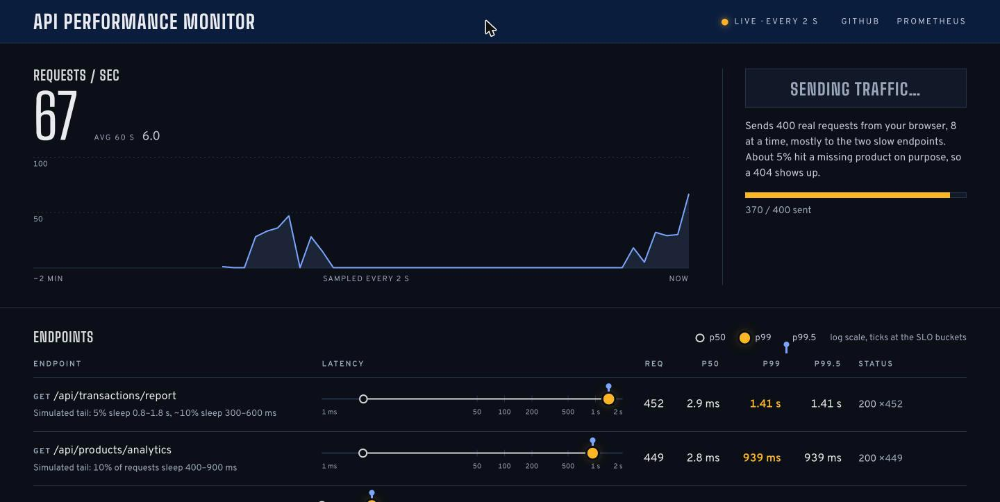

# API Performance Monitor

A Spring Boot API that measures itself, plus a live dashboard to watch it happen. Press **Generate traffic**, and 400 real requests leave your browser. The server's own Micrometer timers turn them into requests/sec and p50 / p99 / p99.5 latency per endpoint, and the dashboard redraws every 2 seconds.

**Live demo:** _dashboard and API links go here after deploy_



More screenshots: [mobile](docs/mobile.png) · [cold start on the free tier](docs/cold-start.png)

## Why

Averages hide the requests users complain about. This project shows the tail: two endpoints add **simulated** latency to a fraction of requests (labeled as such in the UI), so you can watch p99 and p99.5 pull away from p50 while the median barely moves. The same numbers are exposed for Prometheus, so the API can also be monitored the standard way.

## What a request goes through

1. **Browser**: the dashboard fires `GET` requests, 8 at a time, about 5% of them to a product that does not exist (404).
2. **Spring MVC**: the controller answers; `/analytics` and `/report` sleep on some requests to simulate a slow dependency.
3. **H2 via JPA**: queries over 500 seeded products and 2,000 seeded transactions (in memory, reset on restart).
4. **Micrometer**: Spring's HTTP observation records every request in a `http.server.requests` timer with histogram percentiles and SLO buckets (50 ms → 1 s).
5. **`/api/metrics/summary`**: `MetricsService` groups the timers by method + URI, merges status codes, and adds RPS (sampled each second by `RpsTracker`) and JVM CPU / heap / uptime. The dashboard polls it every 2 s; Prometheus scrapes `/actuator/prometheus`.

## Architecture

```mermaid
flowchart LR
    subgraph Browser
        D[React dashboard<br/>Vite + TypeScript]
    end
    subgraph "Spring Boot 4 · Java 25"
        C[Product / Transaction<br/>controllers] --> S[Services<br/>simulated tail latency] --> DB[(H2 in-memory<br/>JPA)]
        O[HTTP observation filter] -. records .-> M[Micrometer<br/>MeterRegistry]
        M --> R[RpsTracker<br/>@Scheduled 1 s]
        M --> MS[MetricsService]
        R --> MS
        MS --> E["/api/metrics/summary"]
        M --> P["/actuator/prometheus"]
    end
    D -- "Generate traffic<br/>400 GETs, 8 concurrent" --> C
    D -- "poll every 2 s" --> E
    PR[Prometheus + Grafana<br/>optional] -- scrape --> P
```

## Run it locally

One command (Docker):

```bash
docker compose up --build
```

- Dashboard: http://localhost:3000
- API: http://localhost:8080/api/metrics/summary

Add Prometheus (http://localhost:9090) and Grafana (http://localhost:3001, Prometheus preconfigured as a data source):

```bash
docker compose --profile monitoring up --build
```

Without Docker (Java 25 is downloaded by Gradle if missing; Node 22+):

```bash
./gradlew bootRun                      # API on :8080
cd frontend && npm install && npm run dev   # dashboard on :5173
```

## Tests

```bash
./gradlew test
```

- `RpsTrackerTest`: per-second deltas and the 60-second rolling average.
- `MetricsServiceTest`: grouping by method + URI, status-code merging, actuator exclusion, percentiles.
- `MetricsSummaryIntegrationTest`: boots the app on a random port, sends real requests (200 and 404), and checks they show up in `/api/metrics/summary`. It also verifies that only `health`, `metrics`, and `prometheus` are exposed and that CORS rejects unknown origins.

No external services are needed. GitHub Actions runs the backend tests and the frontend lint + build on every push.

## Configuration

| Variable | Where | Default | Purpose |
| --- | --- | --- | --- |
| `CORS_ALLOWED_ORIGINS` | backend | `http://localhost:5173` | Comma-separated origins allowed to call `/api/**` |
| `PORT` | backend | `8080` | HTTP port (set by Render) |
| `VITE_API_URL` | frontend (build time) | `http://localhost:8080` | Backend base URL |

## API

| Endpoint | Notes |
| --- | --- |
| `GET /api/metrics/summary` | RPS, per-endpoint latency percentiles and status codes, JVM stats |
| `GET /api/products/analytics` | ~10% of requests sleep 400–900 ms (simulated) |
| `GET /api/transactions/report` | ~5% sleep 0.8–1.8 s, ~10% sleep 300–600 ms (simulated) |
| `GET/POST/PUT/DELETE /api/products[/{id}]` | CRUD over seeded products |
| `GET/POST /api/transactions[/{id}]` | Seeded transactions |
| `GET /actuator/health`, `/actuator/metrics`, `/actuator/prometheus` | Only these actuator endpoints are exposed |

## Notes on the numbers

- Percentiles are Micrometer client-side histogram estimates over a rolling ~2-minute window. When an endpoint gets no traffic for a while, its percentiles drop to zero while its request count stays cumulative; the dashboard shows "No requests in the last 2 min".
- Latency for an endpoint comes from its busiest status-code timer (normally the 2xx one).
- RPS includes the dashboard's own polling, which appears as its own row.
- On the free hosting tier the server sleeps after 15 minutes idle; the first visit can take 30–60 s while the JVM boots, and the dashboard says so.

## Stack

Java 25 · Spring Boot 4.1 · Spring Data JPA · H2 · Micrometer · Spring Boot Actuator · Prometheus · React 19 · TypeScript · Vite · Docker · GitHub Actions
